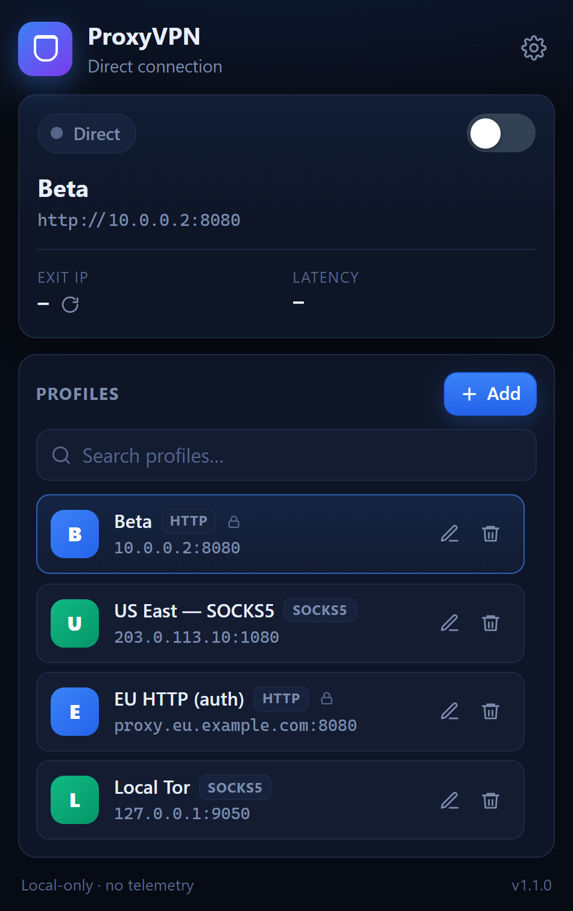
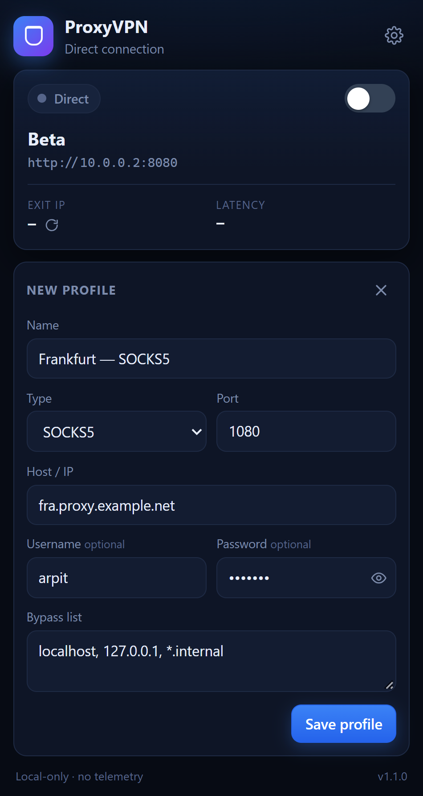
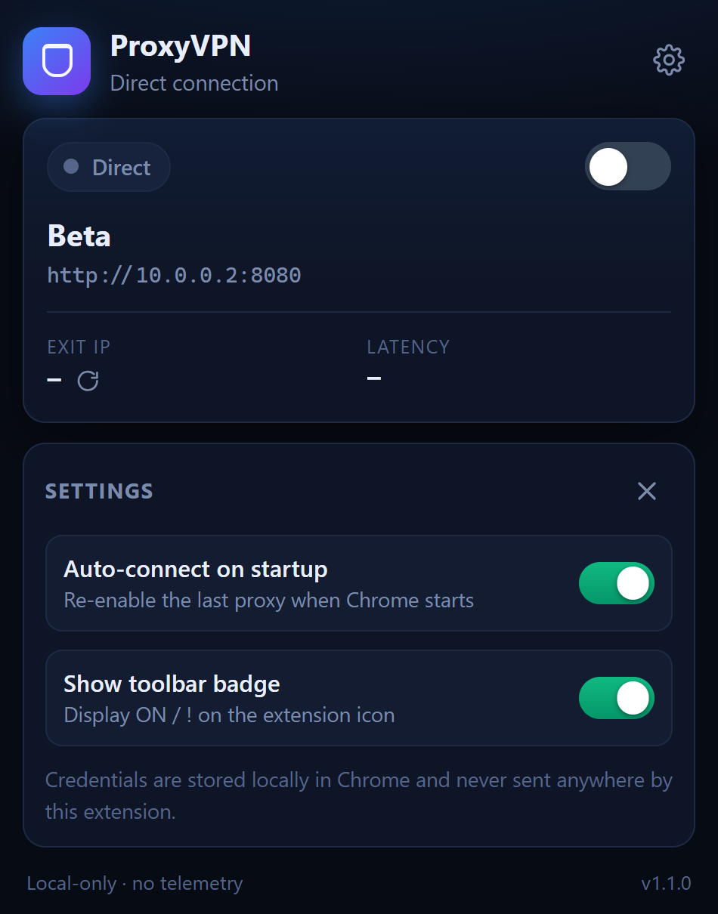

# ProxyVPN — Proxy Profile Switcher

A lightweight Chrome extension that turns Chrome's proxy settings into a simple
on/off switch. Save named **HTTP / HTTPS / SOCKS4 / SOCKS5** proxies and toggle
them like a VPN — one click to route through a proxy, one click to go direct.

Built with **Manifest V3**. No account, no telemetry, no remote code.



## Features

- **One-click switch** — flips Chrome between the selected proxy and a direct
  connection. The toolbar badge shows `ON` when active.
- **Named profiles** — save as many proxies as you want and switch between them,
  with search to find one fast.
- **HTTP · HTTPS · SOCKS4 · SOCKS5** — all the schemes Chrome supports.
- **Proxy authentication** — optional username/password per profile, answered
  automatically on HTTP 407 challenges.
- **Per-profile bypass list** — hosts that always go direct (`localhost`,
  `127.0.0.1`, `*.internal`, …). Loopback is kept direct by default.
- **Check exit IP + latency** — confirm the proxy is actually working.
- **Auto-connect on startup** — bring your proxy back when Chrome starts.
- **Inline two-step delete** — safe deletes without modal prompts.
- **Local-only storage** — profiles and credentials live in `chrome.storage.local`.

| Add / edit a profile | Settings |
|---|---|
|  |  |

## Install (load unpacked)

1. Open `chrome://extensions`.
2. Turn on **Developer mode** (top-right).
3. Click **Load unpacked** and select this folder.
4. Pin **ProxyVPN** from the toolbar's puzzle-piece menu.

> Chrome 137+ removed the `--load-extension` command-line flag, so for
> development use the **Load unpacked** button (or the Chrome DevTools Protocol
> `Extensions.loadUnpacked` command). `dev/` contains helper scripts.

## Usage

1. Click the toolbar icon.
2. Click **+ Add** and fill in a name, type, host and port (plus username /
   password if your proxy needs them), then **Save profile**.
3. Click a profile card to connect — or flip the master switch with a profile
   selected.
4. Hit **Check exit IP** to confirm the new egress address.
5. Flip the switch off to return to a direct connection.

## How it works

- `background.js` is a service worker and the single owner of state. It applies
  Chrome's proxy configuration with `chrome.proxy.settings.set` using
  `fixed_servers` / `singleProxy`, or `direct` when the switch is off.
- An in-memory mirror of the stored profiles lets the `webRequest.onAuthRequired`
  handler answer proxy auth challenges synchronously.
- `popup.js` is a thin controller: it sends messages (`getState`, `setEnabled`,
  `selectProfile`, `saveProfile`, `deleteProfile`, `updateSettings`,
  `testConnection`) and renders whatever the worker returns.

```
popup  ──message──▶  background service worker  ──▶  chrome.proxy.settings
                            │
                            └── chrome.storage.local  (profiles + settings)
```

## Permissions

| Permission | Why |
|---|---|
| `proxy` | Change Chrome's proxy configuration (the extension's single purpose). |
| `storage` | Persist profiles, the active selection and preferences locally. |
| `webRequest` + `webRequestAuthProvider` | Answer proxy auth challenges with saved credentials. |
| `<all_urls>` | Required by `webRequest` so auth can be handled on any host. Page content is never read or modified. |

## Privacy

ProxyVPN collects nothing. Profiles and credentials are stored locally in Chrome
and are never sent to us. The **only** external request is `api.ipify.org`, made
solely when you click **Check exit IP**. See [`dev/store/PRIVACY.md`](dev/store/PRIVACY.md).

## Project layout

```
proxyvpn/
├── manifest.json              # Manifest V3
├── background.js              # service worker: state + chrome.proxy + auth
├── popup.html                 # toolbar popup markup
├── popup.css                  # popup styles
├── popup.js                   # popup controller
├── icons/                     # 16 / 48 / 128 px icons
├── dev/
│   ├── preview.html           # generated standalone UI preview
│   ├── preview-mock.js        # chrome.* mock used by the preview
│   ├── make-preview.mjs       # regenerates preview.html from the real popup
│   ├── make-icons.ps1         # regenerates the icons
│   ├── docs/                  # screenshots used in this README
│   └── store/
│       ├── template.html      # store screenshot compositor
│       ├── make-store-shots.ps1
│       ├── STORE_LISTING.md   # ready-to-paste Web Store copy
│       ├── PRIVACY.md         # privacy policy
│       └── store-*.png        # 1280×800 store screenshots
└── README.md
```

## Development

**Preview the UI without installing** — open `dev/preview.html` in any browser.
It is generated from the real `popup.html` / `popup.css` / `popup.js` with a
mocked `chrome.*` API, so it cannot drift out of sync:

```bash
node dev/make-preview.mjs
```

**Regenerate the icons** (Windows, uses `System.Drawing`):

```powershell
powershell -ExecutionPolicy Bypass -File .\dev\make-icons.ps1
```

**Regenerate the store screenshots** (1280×800):

```powershell
powershell -ExecutionPolicy Bypass -File .\dev\store\make-store-shots.ps1
```

## Publishing to the Chrome Web Store

Packaging and listing copy are ready in
[`dev/store/STORE_LISTING.md`](dev/store/STORE_LISTING.md). In short:

1. Bump `version` in `manifest.json`.
2. ZIP only the runtime files: `manifest.json`, `background.js`, `popup.html`,
   `popup.css`, `popup.js`, `icons/`.
3. Upload in the Developer Dashboard and fill in the listing + privacy answers
   from `STORE_LISTING.md`.

## Security notes

- Credentials are stored **unencrypted** in `chrome.storage.local`, readable by
  anyone with access to your Chrome profile on disk. Use dedicated proxy
  accounts.
- A proxy operator can see and modify plaintext HTTP traffic and the metadata of
  HTTPS traffic. Only use proxies you trust.
- ProxyVPN changes **Chrome's** proxy only; other apps and the OS keep their own
  network settings.

## License

MIT — see [LICENSE](LICENSE). © 2026 Arpit Singh.

> **Authorized use only.** Use only with proxies and networks you are authorised
> to use. You are responsible for complying with all applicable laws.
